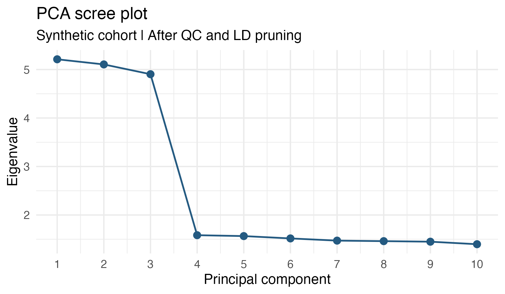

# Genotype QC and PCA

**Synthetic cohort with four simulated groups**

| Metric | Before QC | After QC |
|---|---:|---:|
| Samples | 100 | 99 |
| Autosomal biallelic SNPs | 1000 | 998 |

**QC thresholds.** Sample missingness at most 10.0%, variant missingness at most 10.0%, and MAF at least 5.0%.

**PCA.** PLINK 2 computed 10 PCs using 998 SNPs after LD pruning (650 kb window, r-squared threshold 0.20). 10 missing genotype calls were mean-imputed during PCA.

The largest adjacent drop was from PC3 to PC4 (4.90 to 1.58).

[PC1 vs PC2](../04_figures/pca_pc1_pc2.png) | [PC2 vs PC3](../04_figures/pca_pc2_pc3.png)

[Sample inventory](../03_tables/sample_inventory.csv)
